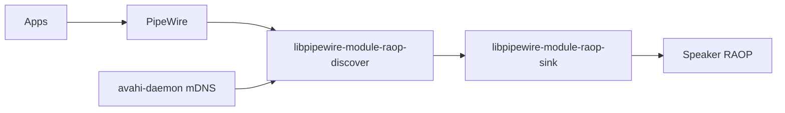

# DespairPlay — design

Diagnostic GTK4/libadwaita app for the Linux AirPlay **sender** stack. It does not implement an AirPlay receiver, screen mirroring, or AirPlay 2 sending.

Folder: `Airplay GUI`. Display name: DespairPlay. Python package / console script: `despairplay`.

## Reality check

Linux can **send** audio to AirPlay speakers via **RAOP (AirPlay 1)** only. The working path on Ubuntu/Zorin is:




- Discovery: Avahi browses `_raop._tcp` (Bonjour).
- Sinks: PipeWire loads `libpipewire-module-raop-discover`, which creates a sink per advertised RAOP service.
- Playback: `libpipewire-module-raop-sink` streams PCM over RAOP (UDP/TCP + RSA/`auth_setup` encryption as advertised).

**Sonos / modern soundbars often advertise** `_airplay._tcp` **(AirPlay 2).** Many still also advertise `_raop._tcp`; if they do not, PipeWire cannot send to them. There is no production-quality AirPlay 2 *audio* sender on Linux. The app must show this as a first-class diagnosis, not a generic “device not found”.

## UI

GNOME Settings–style **split view**, not one long checklist. `Adw.NavigationSplitView`: narrow sidebar of things you can hear, wide pane for the selected item plus diagnosis.

```text
┌─ Sidebar ────────┬─ Main ──────────────────────────┐
│ Overview         │ Banner (ready / issues / AP2)   │
│                  │ PreferencesGroups for that page │
│ AirPlay          │                                 │
│  🔊 Soundbar     │                                 │
│  ⚠  Sonos (AP2)  │                                 │
│                  │                                 │
│ This PC          │                                 │
│  🖥 HDMI         │                                 │
│  🔊 Speakers     │                                 │
└──────────────────┴─────────────────────────────────┘
```

**Sidebar** (two labelled `Gtk.ListBox`es, CSS class `navigation-sidebar`, `Adw.ActionRow`s):

1. **Overview** — always first. Opens Audio system + Network. Badge if fail/warn count > 0.
2. **AirPlay** — discovered `_raop._tcp` / `_airplay._tcp` devices (name, warning icon if AirPlay 2-only or no PipeWire sink). Empty copy: “No AirPlay speakers on the network.”
3. **This PC** — local PipeWire **output sinks** (`Audio/Sink` that are not RAOP), plus other available card outputs such as S/PDIF that are not the active profile. Same idea as GNOME Settings → Sound → Output.

Selecting a row only **inspects**. It does **not** change the default sink (volume-blast trap). A later “Set as output” can exist with a volume cap.

**Main pane** — `Adw.ToolbarView` + header (title of selection, Refresh). When all checks pass: light grey **Ready** bar with a green circle-tick before the word. Problems still use `Adw.Banner` (issues / AirPlay 2-only). Check results are static cards, not `Adw.PreferencesPage` boxed-list rows (those always hover).

- Overview: Audio system, Network (Fix on the row when safe). Fail/warn stay on those rows; there is no separate Issues list.
- AirPlay device: IP:port, `_raop` vs `_airplay`, TXT (`et`, `cn`, `tp`, `am`), whether a RAOP sink exists, AirPlay 2-only explanation, related Fix.
- This PC sink: PipeWire name, ports, current default marker (informational only).

**Icons** — theme symbolic names only (no custom artwork), same family as GNOME Settings:


| Use                        | Icon name                                                                     |
| -------------------------- | ----------------------------------------------------------------------------- |
| Overview / setup           | `emblem-system-symbolic`                                                      |
| AirPlay / generic speaker  | `audio-speakers-symbolic`                                                     |
| Headphones / headset       | `audio-headphones-symbolic` / `audio-headset-symbolic`                        |
| Internal / HDMI / USB card | `audio-card-symbolic`                                                         |
| This PC section            | `computer-symbolic`                                                           |
| Network / mDNS             | `network-workgroup-symbolic`                                                  |
| AirPlay 2-only / warn      | `dialog-warning-symbolic` (triangle)                                          |
| Fail                       | `dialog-error-symbolic` (circle with bar)                                     |
| OK                         | `emblem-default-symbolic` (filled circle with tick), 28px, Adwaita `.success` |
| Refresh                    | `view-refresh-symbolic`                                                       |


Prefer PipeWire `device.icon-name` / `media.icon-name` when it is a `*-symbolic` name from the theme; otherwise the table above.

Refresh on a timer (~3s) for device appearance; full check suite on open and on Refresh. Narrow windows: `NavigationSplitView` collapsed (show sidebar or content, GNOME Settings behaviour).

## Checks (v1)

Each check returns `ok | warn | fail`, a short reason, evidence (command/path)

**PipeWire / RAOP**

- User units active: `pipewire`, `pipewire-pulse`, `wireplumber`
- `libpipewire-module-raop-discover.so` and `...-raop-sink.so` under `/usr/lib/*/pipewire-0.3/`
- Discover module loaded: `pw-dump` PipeWire module, or `pactl` `module-raop-discover` (GNOME [pipewire-airplay-toggle](https://github.com/craw0967/pipewire-airplay-toggle)), or live RAOP sinks
- Autostart: PipeWire drop-in, **or** GNOME AirPlay toggle extension (do not write a permanent drop-in if the toggle is the intended UX)
- RAOP sinks in the graph (`pw-dump` / `wpctl status`)

**Avahi / mDNS**

- Packages: `avahi-daemon`, `avahi-utils`, `libnss-mdns`
- `avahi-daemon` active
- Avahi D-Bus browse of `_raop._tcp` and `_airplay._tcp` (do not shell out to `avahi-browse` as the primary path)
- `nsswitch.conf` `hosts:` contains `mdns4_minimal` / `mdns_minimal`
- UDP 5353 listener; multicast on default-route iface

**Firewall / LAN**

- If UFW is active: UDP 5353; warn if 6001/6002 UDP not allowed
- firewalld equivalent if present
- Warn on active VPN interfaces (multicast often broken)
- Do not “fix” AP isolation / VLAN / guest Wi-Fi — explain it

## Implementation notes

- Prefer Avahi D-Bus (`org.freedesktop.Avahi`) and `pw-dump` JSON over scraping CLI text.
- Package detection: `dpkg-query` / file existence — Ubuntu names, not Arch `pipewire-zeroconf`.
- TXT parsing: `et=`, `cn=`, `tp=`, `pw=`, `am=` for “why won’t this connect” copy.
- Tests: fixture JSON for `pw-dump`, Avahi TXT, UFW status. Default pytest is offline. Mark live tests `@pytest.mark.integration`.


## Success on Ubuntu and Zorin

The app shows Avahi up/down, whether RAOP modules exist and are loaded, lists the soundbar and Sonos if they advertise, and one-click enables Avahi + writes the PipeWire drop-in + restarts so the speaker appears in the sound menu. If the Sonos is AirPlay 2-only, it says so in plain language.